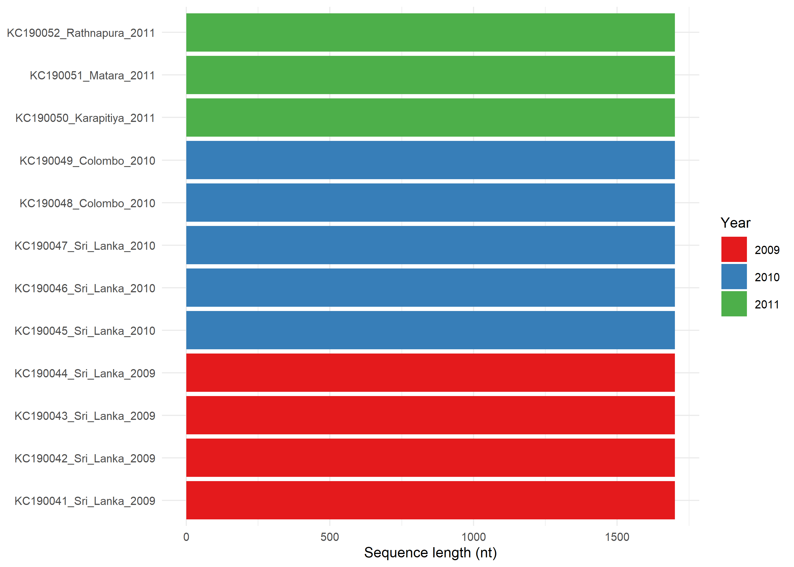
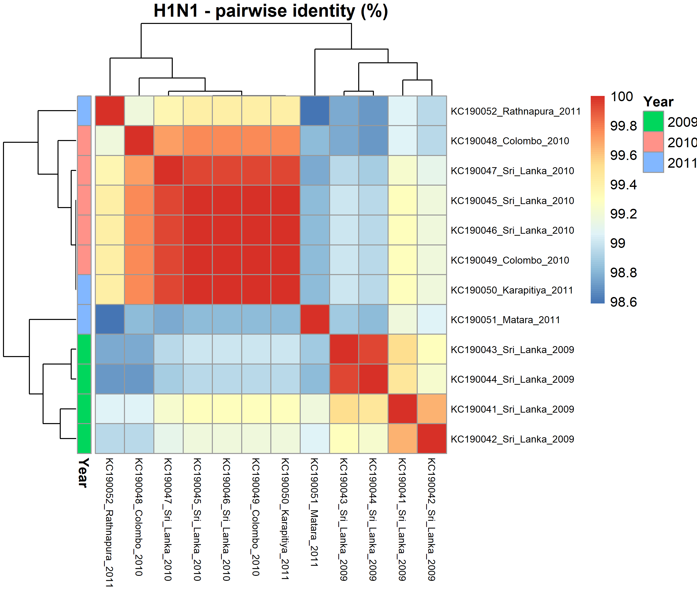
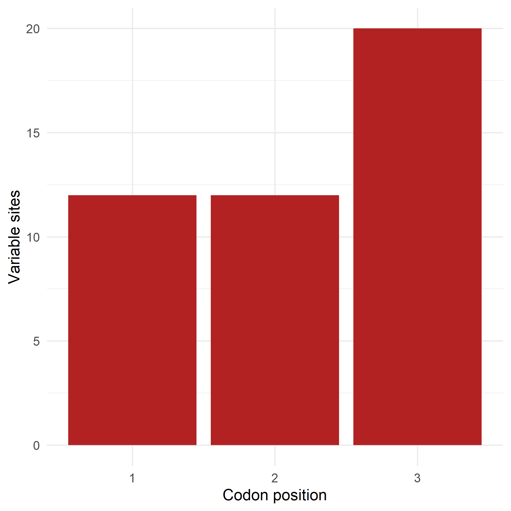

# Comparative Sequence Analysis of the Hemagglutinin (HA) Gene of Influenza A (H1N1) Viruses from Sri Lanka, 2009-2011

**Student registration number:** 2021/ICT/100
**Name:** Bavaruba Kuventhirarasa
**Module:** Bioinformatics, ICA3 (2026)

---

## 1. Abstract

Influenza viruses change genetically over time, which affects vaccine design and surveillance. We analysed 12 hemagglutinin (HA) gene sequences of influenza A (H1N1) viruses collected in Sri Lanka between 2009 and 2011 (NCBI GenBank). We calculated nucleotide composition and GC content, aligned the sequences with Clustal Omega, identified conserved and variable regions, and built a neighbour-joining tree in R. Mean GC content was 40.6% and did not differ significantly between years (Kruskal-Wallis p = 0.095). Sequences were 99.3% identical on average; 44 of 1,701 positions (2.6%) were variable, most at the third codon position, and 23 of 567 amino-acid positions varied. The tree grouped the four 2009 sequences together, but clustering by year was only partial.

## 2. Introduction

Influenza is an acute respiratory disease caused by RNA viruses. Influenza A viruses are divided into subtypes by their two surface proteins, hemagglutinin (HA) and neuraminidase (NA). HA binds the virus to sialic acid receptors on host cells, helps the viral membrane fuse with the cell, and is the main target of neutralising antibodies (Skehel and Wiley, 2000).

The influenza RNA polymerase has no proofreading, so HA accumulates mutations over time (antigenic drift), which is why vaccines need regular updating. Comparing HA sequences shows **which parts of the gene change and which stay conserved**, and how closely viruses are related. Local sequence data are valuable because they show how viruses circulated in a particular country.

**Aim:** To compare HA gene sequences of influenza A (H1N1) viruses collected in Sri Lanka (2009-2011) to describe their nucleotide composition, identify conserved and variable regions, and explore their genetic relationships.

**Questions:**
1. Does GC content differ between years of collection (2009, 2010, 2011)?
2. Is variation spread evenly along the gene, or concentrated in particular regions and codon positions? (Expected: more changes at the third codon position.)
3. Do the sequences cluster by year of collection or by location?

## 3. Data

- **Source:** NCBI GenBank (Sayers et al., 2022). The records were downloaded as FASTA and stored unchanged in `data/raw_download_all_segments.fasta`.
- **Raw file:** 20 records. Twelve are HA (segment 4) sequences (accessions KC190041-KC190052). The other eight are different gene segments (PB2, PB1, PA, NP, NA, MP, NS) and were removed because they are not HA. The cleaning is done in `code/01_prepare_data.R`.
- **Final data set:** 12 HA coding sequences, each 1,701 nucleotides (start codon ATG, stop codon TAA), collected in Sri Lanka: 4 in 2009, 5 in 2010 and 3 in 2011. Locations were Sri Lanka (7 records), Colombo (2), Karapitiya (1), Matara (1) and Rathnapura (1). The subtype is H1N1, as labelled in the downloaded data set.
- **Variables:** accession, location, year, collection date, sequence length (`data/ha_metadata.csv`).
- **Ethics and licence:** GenBank data are public and free to use; the original submitters are acknowledged by citing the accessions. No human subject data are used.

## 4. Methods

All analysis was done in R in `code/02_analysis.Rmd`.

1. **Import and quality control.** Sequences were read with `Biostrings`. Length and ambiguous bases were checked (sequences with more than 1% ambiguous bases would be removed).
2. **Nucleotide composition and GC content.** The percentage of A, C, G and T was calculated with `alphabetFrequency()`; GC content = (G + C) / (A + C + G + T) × 100. GC content was compared between years with a Kruskal-Wallis test, chosen because the groups are small and normality cannot be assumed.
3. **Multiple sequence alignment.** Sequences were aligned with Clustal Omega (Sievers et al., 2011) through the `msa` package (Bodenhofer et al., 2015).
4. **Conserved and variable regions.** For each alignment position I calculated the fraction of sequences with the most common base. A position is *variable* if at least two different bases occur. Conservation was smoothed with a 30-nt sliding window, and *conserved blocks* were defined as at least 30 consecutive identical positions. Pairwise identity was calculated with `ape::dist.dna`.
5. **Codon positions and amino acids.** Because all sequences are complete coding sequences, variable sites were counted by codon position, and the sequences were translated to find variable amino-acid positions.
6. **Phylogenetic analysis.** A neighbour-joining tree (Saitou and Nei, 1987) was built from Kimura 2-parameter distances with `ape` (Paradis and Schliep, 2019), with 100 bootstrap replicates. Neighbour-joining is fast and suitable for a small data set but less accurate than maximum likelihood.
7. **Visualisation.** `ggplot2` (part of the tidyverse; Wickham et al., 2019) and `pheatmap` (Kolde).

## 5. Results

### 5.1 Sequence quality

All 12 sequences were 1,701 nucleotides long. Four sequences (KC190049-KC190052) contained 1 to 3 ambiguous bases (6 in total), well below the 1% limit, so no sequence was removed.


*Figure 1. Length of each HA sequence, coloured by year of collection.*

### 5.2 Nucleotide composition and GC content

| Year | n | %A | %C | %G | %T | %GC (mean ± sd) |
|---|---|---|---|---|---|---|
| 2009 | 4 | 35.30 | 18.47 | 22.25 | 23.97 | 40.73 ± 0.13 |
| 2010 | 5 | 35.52 | 18.58 | 21.97 | 23.93 | 40.55 ± 0.03 |
| 2011 | 3 | 35.50 | 18.63 | 21.95 | 23.91 | 40.58 ± 0.11 |

HA is rich in adenine (about 35%), as is typical of influenza genes. GC content was about 40.6% overall (range 40.51-40.86%). The difference between years was only about 0.2 percentage points and was not significant (Kruskal-Wallis χ² = 4.71, df = 2, p = 0.095).


*Figure 2. Nucleotide composition (% A, C, G, T) of each HA sequence.*


*Figure 3. GC content (%) of each sequence, coloured by year of collection.*


*Figure 4. GC content by year of collection. Kruskal-Wallis test: χ² = 4.71, df = 2, p = 0.095.*

### 5.3 Conserved and variable regions

Of 1,701 aligned positions, 1,657 were identical in all sequences and 44 (2.6%) were variable. Mean pairwise identity was 99.27% (minimum 98.59%). There were 22 conserved blocks of at least 30 nucleotides; the longest were positions 1231-1367 (137 nt), 818-953 (136 nt) and 1561-1653 (93 nt). Variable sites were spread across the gene, with 0 to 5 per 100-nt bin and the highest number (5) at positions 301-400, so there was no strong clustering of variation.


*Figure 5. Conservation along the alignment (30-nt window).*


*Figure 6. Variable sites per 100-nt bin.*


*Figure 7. Pairwise nucleotide identity (%) between sequences.*

### 5.4 Genetic relationships

In the neighbour-joining tree, the four 2009 sequences formed a group with high bootstrap support (96%). Two 2011 sequences (from Matara and Rathnapura) joined this group with support of 97% and 82%. Five sequences from 2010-2011 (including those from Colombo and Karapitiya) formed another group (85%), while one 2010 Colombo sequence (KC190048) did not join either group. Many branches were extremely short and several had low support (below 70%), because the sequences are so similar. Clustering by year was therefore only partial, and no clear clustering by location was seen.


*Figure 8. Neighbour-joining tree (Kimura 2-parameter distance). Bootstrap values of 70% or more are shown (100 replicates); tip colour = year of collection.*

### 5.5 Codon positions and amino-acid changes

| Codon position | Sites | Variable sites | % variable |
|---|---|---|---|
| 1 | 567 | 12 | 2.1 |
| 2 | 567 | 12 | 2.1 |
| 3 | 567 | 20 | 3.5 |

The third codon position had the most variable sites (20 of 44), in line with the expectation, although the difference was modest. After translation, 23 of 567 amino-acid positions (566 residues plus the stop codon) were variable, at positions 12, 88, 101, 103, 114, 138, 155, 200, 202, 222, 233, 237, 239, 266, 273, 338, 366, 370, 373, 391, 468, 552 and 553.


*Figure 9. Variable nucleotide sites at each codon position.*

## 6. Discussion

**Composition.** The HA genes were rich in adenine and had a stable GC content of about 40.6%. GC content did not differ significantly between 2009, 2010 and 2011 (p = 0.095). With only 3 to 5 sequences per year the test has little power, so this means there is no evidence of a difference and not that none exists. The differences observed were very small (about 0.2 percentage points) and are unlikely to be biologically meaningful.

**Variation.** The 12 sequences were very similar (mean identity 99.27%), and only 2.6% of positions varied. Variation was spread along the whole gene and not concentrated in one region, although the small number of variable sites makes any regional pattern hard to detect. The third codon position carried the most variable sites, which is expected because many changes at this position are synonymous and do not alter the amino acid, so selection removes them less strongly. Even so, 23 amino-acid positions varied, showing that some changes do alter the HA protein. I did not test whether these positions lie in antigenic sites, which would need the protein structure or published antigenic-site maps. The long conserved blocks (for example positions 1231-1367 and 818-953) suggest regions under strong constraint, which could be useful targets for diagnostic primers.

**Relationships.** The tree grouped the 2009 sequences together, which suggests that viruses sampled at the same time were closely related, but sequences from 2010 and 2011 did not form clean year-specific groups, and two 2011 sequences were close to the 2009 group. Because the sequences differ at so few positions, many branches are very short and have low bootstrap support, so the exact branching order should be interpreted with caution. The tree is unrooted, so it does not show which sequences are ancestral.

**Limitations.** The data set is small (12 sequences), covers one subtype, one country and only three years, and the sampling may be biased by which samples were sequenced and submitted to GenBank. The tree was built with neighbour-joining, which is less accurate than maximum likelihood, and no test for selection (dN/dS) was done. Alignment positions equal codon positions here only because all sequences are complete coding sequences of equal length.

**Real-world implications.** Even a small local data set shows that HA in Sri Lanka changed slowly over 2009-2011 but kept accumulating amino-acid differences. Regular sequencing of local viruses supports surveillance and helps decide whether vaccine strains still match circulating viruses.

## 7. Conclusion and future work

GC content of the HA gene was stable at about 40.6% and did not differ significantly between years (p = 0.095). The 12 sequences were 99.3% identical; 44 nucleotide positions (2.6%) were variable, most at the third codon position, and 23 amino-acid positions varied. The tree showed only partial clustering by year (the 2009 sequences grouped together) and no clear clustering by location, with low support on many branches because of the high similarity.

Future work: add H3N2 or global H1N1 sequences for comparison, build maximum-likelihood trees (`phangorn` or IQ-TREE), run dN/dS analysis to detect selection, map variable sites onto the HA protein structure, and analyse the other gene segments.

## 8. Reproducibility

```
├── README.md                       report
├── code/
│   ├── 00_install_packages.R       installs packages
│   ├── 01_prepare_data.R           keeps HA sequences, builds metadata
│   ├── 02_analysis.Rmd             full analysis
│   └── 02_analysis.html            rendered output
├── data/                           raw FASTA, cleaned FASTA, metadata
├── figures/                        figures used in this report
└── results/                        tables, alignment, tree
```

1. Clone the repository and open the folder as an RStudio project.
2. Run `source("code/00_install_packages.R")` (first time only).
3. Run `source("code/01_prepare_data.R")` (the cleaned files are already in `data/`).
4. Run `rmarkdown::render("code/02_analysis.Rmd")`. The HTML appears in `code/`, figures in `figures/` and tables in `results/`.

Package versions are printed with `sessionInfo()` at the end of `code/02_analysis.html`. The random seed is set with `set.seed(2026)` for the bootstrap.

## 9. References

- Bodenhofer U, Bonatesta E, Horejs-Kainrath C, Hochreiter S (2015). msa: an R package for multiple sequence alignment. *Bioinformatics* 31(24):3997-3999.
- Kolde R. pheatmap: Pretty Heatmaps. R package.
- Pagès H, Aboyoun P, Gentleman R, DebRoy S. Biostrings: Efficient manipulation of biological strings. R/Bioconductor package.
- Paradis E, Schliep K (2019). ape 5.0: an environment for modern phylogenetics and evolutionary analyses in R. *Bioinformatics* 35(3):526-528.
- R Core Team. R: A Language and Environment for Statistical Computing. R Foundation for Statistical Computing, Vienna, Austria. https://www.R-project.org/
- Saitou N, Nei M (1987). The neighbor-joining method: a new method for reconstructing phylogenetic trees. *Molecular Biology and Evolution* 4(4):406-425.
- Sayers EW, et al. (2022). Database resources of the National Center for Biotechnology Information. *Nucleic Acids Research* 50(D1):D20-D26.
- Sievers F, et al. (2011). Fast, scalable generation of high-quality protein multiple sequence alignments using Clustal Omega. *Molecular Systems Biology* 7:539.
- Skehel JJ, Wiley DC (2000). Receptor binding and membrane-fusion in virus entry: the influenza hemagglutinin. *Annual Review of Biochemistry* 69:531-569.
- Wickham H, et al. (2019). Welcome to the tidyverse. *Journal of Open Source Software* 4(43):1686.
- **Dataset:** NCBI GenBank accessions KC190041-KC190052 (`data/selected_accessions.csv`), https://www.ncbi.nlm.nih.gov/genbank/. Accessed November 2026.
