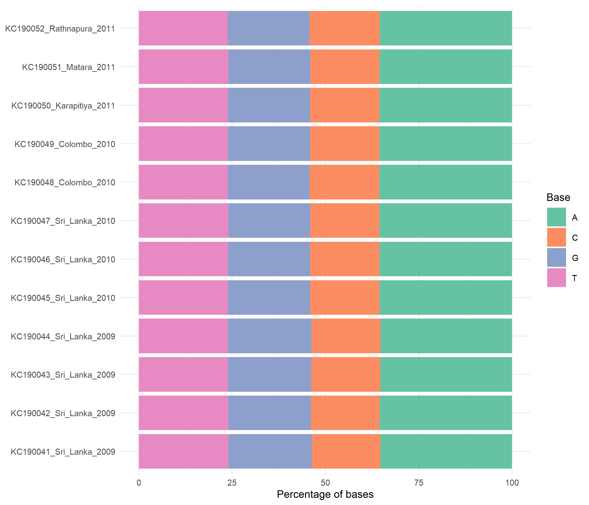
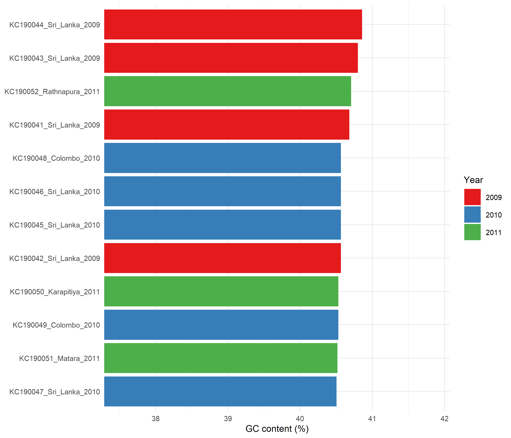
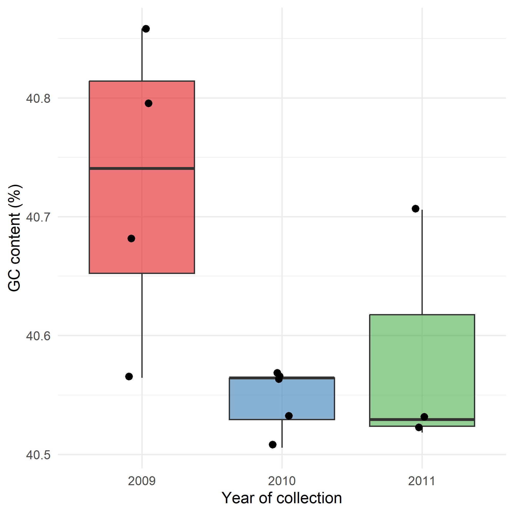
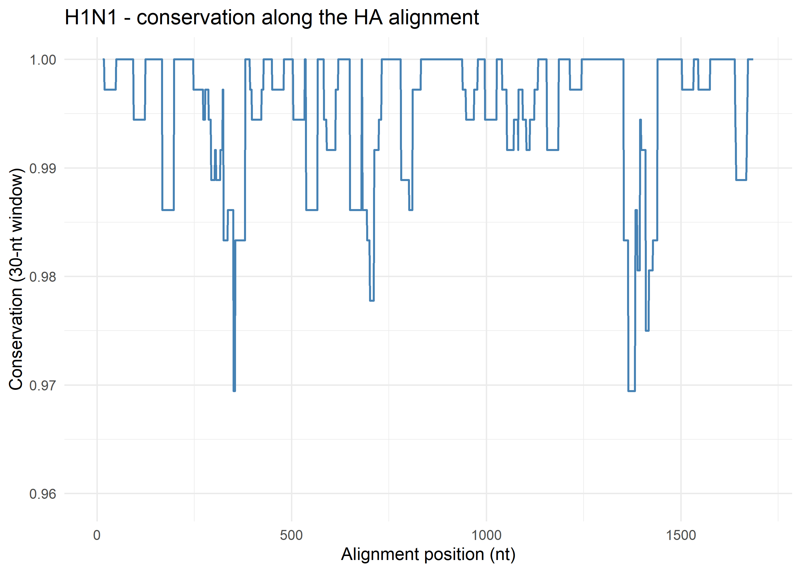
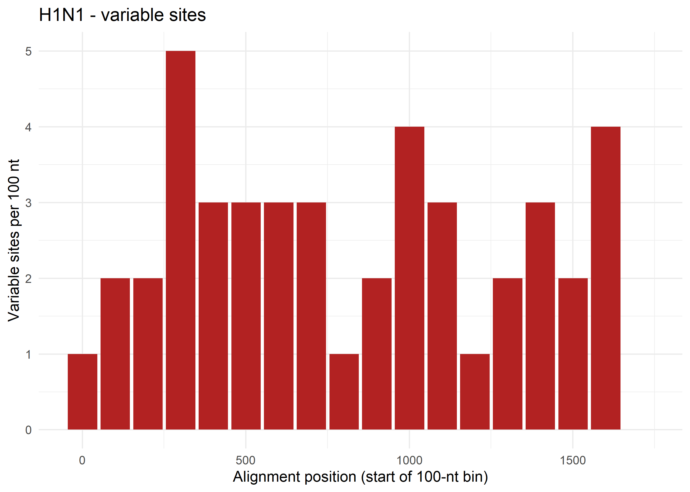
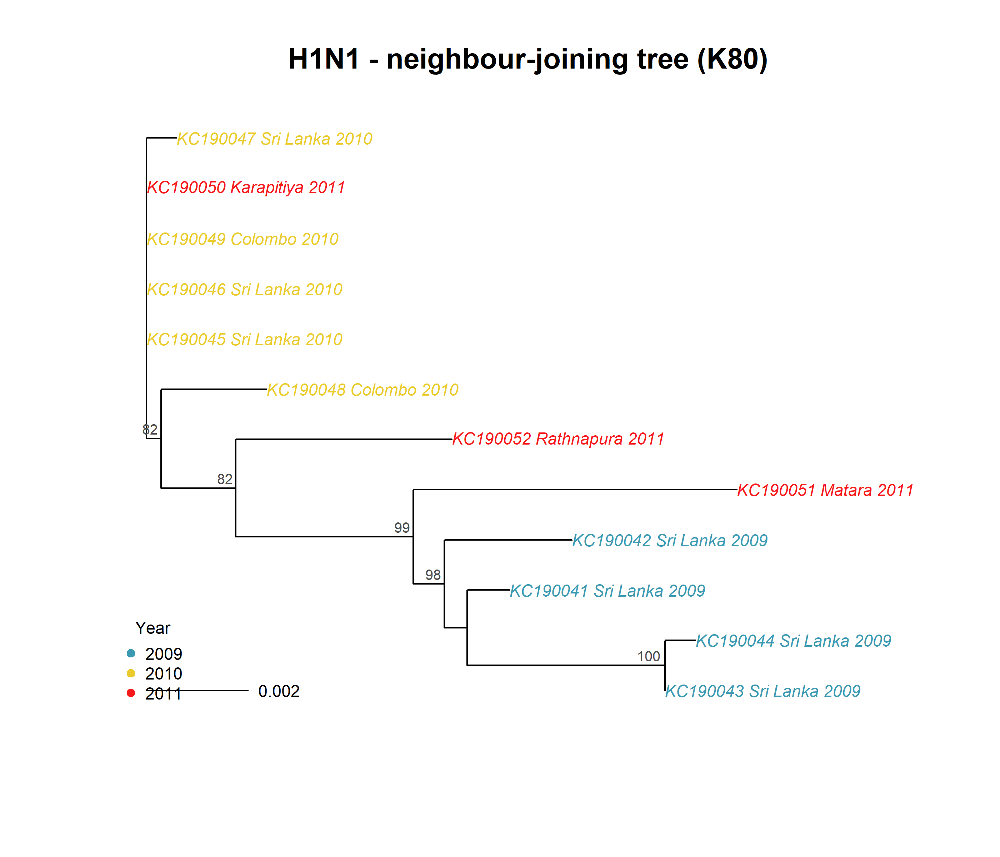

# Comparative Sequence Analysis of the Hemagglutinin (HA) Gene of Influenza A (H1N1) Viruses from Sri Lanka, 2009-2011

**Student registration number:** `[ 2021/ICT/100]`  **Name:** Bavaruba Kuventhirarasa
**Module:** Bioinformatics, ICA3 (2026)


---

## 1. Abstract

[Influenza viruses change genetically over time, which
affects vaccine design and surveillance. We analysed 12 hemagglutinin (HA) gene sequences of
influenza A (H1N1) viruses collected in Sri Lanka between 2009 and 2011 (NCBI GenBank). We
calculated nucleotide composition and GC content, aligned the sequences with Clustal Omega,
identified conserved and variable regions and built a neighbour-joining tree in R. Mean GC
content was `[x]`%, sequences were `[x]`% identical on average, and `[n]` of 1,701 nucleotide
positions were variable, mostly at the `[third]` codon position. The tree showed `[pattern]`.]

## 2. Introduction

Influenza is an acute respiratory disease caused by RNA viruses. Influenza A viruses are
divided into subtypes by their surface proteins hemagglutinin (HA) and neuraminidase (NA).
HA binds the virus to sialic acid receptors on host cells, helps the viral membrane fuse with
the cell, and is the main target of neutralising antibodies (Skehel and Wiley, 2000).

The influenza RNA polymerase has no proofreading, so HA accumulates mutations over time
(antigenic drift), which is why vaccines need regular updating. Comparing HA sequences shows
**which parts of the gene change and which stay conserved**, and how closely viruses are
related. Local sequence data are valuable because they show how viruses circulated in a
particular country.

**Aim:** To compare HA gene sequences of influenza A (H1N1) viruses collected in Sri Lanka
(2009-2011) to describe their nucleotide composition, identify conserved and variable regions,
and explore their genetic relationships.

## 3. Data

- **Source:** NCBI GenBank (Sayers et al., 2022), nucleotide records downloaded as FASTA and
  stored in `data/raw_download_all_segments.fasta`.
- **Raw file:** 20 records. Twelve are HA (segment 4) sequences (accessions KC190041-KC190052);
  the other eight are different gene segments (PB2, PB1, PA, NP, NA, MP, NS) and were removed
  because they are not HA. Cleaning is done in `code/01_prepare_data.R`.
- **Final data set:** 12 HA coding sequences, each 1,701 nucleotides, collected in Sri Lanka
  (`[n]` in 2009, `[n]` in 2010, `[n]` in 2011), from `[locations: Sri Lanka, Colombo,
  Karapitiya, Matara, Rathnapura]`. Subtype H1N1;`.
- **Variables:** accession, location, year, collection date, sequence length.
- **Associat
- **Ethics and licence:** GenBank data are public and free to use; the original submitters are
  acknowledged by citing the accessions. No human subject data are used.

## 4. Methods

All analysis was done in R  in `code/02_analysis.Rmd`.

1. **Import and quality control.** Sequences were read with `Biostrings`. Length and ambiguous
   bases were checked (sequences with more than 1% ambiguous bases would be removed).
2. **Nucleotide composition and GC content.** The percentage of A, C, G and T was calculated
   with `alphabetFrequency()`; GC content = (G + C) / (A + C + G + T) × 100. GC content was
   compared between years with a Kruskal-Wallis test, chosen because groups are small and
   not assumed to be normal.
3. **Multiple sequence alignment.** Sequences were aligned with Clustal Omega
   (Sievers et al., 2011) through the `msa` package (Bodenhofer et al., 2015).
4. **Conserved and variable regions.** For each alignment position I calculated the fraction
   of sequences with the most common base. A position is *variable* if at least two different
   bases occur. Conservation was smoothed with a 30-nt sliding window; *conserved blocks* were
   ≥30 consecutive identical positions. Pairwise identity was calculated with `ape::dist.dna`.
5. **Codon positions and amino acids.** Because all sequences are complete coding sequences,
   variable sites were counted by codon position, and the sequences were translated to find
   variable amino-acid positions.
6. **Phylogenetic analysis.** Neighbour-joining trees (Saitou and Nei, 1987) were built from
   Kimura 2-parameter distances with `ape` (Paradis and Schliep, 2019), with 100 bootstrap
   replicates. Neighbour-joining is fast and suitable for a small data set but less accurate
   than maximum likelihood.
7. **Visualisation.** `ggplot2` and `pheatmap` (Wickham et al., 2019).

## 5. Results

### 5.1 Sequence quality


*Figure 1. Length of each HA sequence, coloured by year of collection.*

### 5.2 Nucleotide composition and GC content


| Year | n | %A | %C | %G | %T | %GC (mean ± sd) |
|---|---|---|---|---|---|---|
| 2009 | [ ] | [ ] | [ ] | [ ] | [ ] | [ ] |
| 2010 | [ ] | [ ] | [ ] | [ ] | [ ] | [ ] |
| 2011 | [ ] | [ ] | [ ] | [ ] | [ ] | [ ] |


*Figure 2. Nucleotide composition of each HA sequence.*


*Figure 3. GC content (%) of each sequence.*


*Figure 4. GC content by year. Kruskal-Wallis test: χ² = [ ], p = [ ].

### 5.3 Conserved and variable regions



*Figure 5. Conservation along the alignment (30-nt window).*


*Figure 6. Variable sites per 100-nt bin.*


*Figure 7. Pairwise nucleotide identity (%).*

### 5.4 Codon positions and amino-acid changes


*Figure 9. Variable nucleotide sites at each codon position.*

### 5.5 Genetic relationships


*Figure 8. Neighbour-joining tree (K2P). Bootstrap values ≥70% shown; tip colour = year.

## 6. Discussion

- **Composition:** interpret the GC content and whether years differ; keep claims modest
  because n is small.
- **Variation:** with about 99% identity the sequences are very similar. Discuss where the
  variable sites are, why the third codon position changes most (many changes do not alter
  the amino acid), and what the amino-acid changes might mean.
- **Relationships:** what the tree suggests about how the viruses were related over the
  2009-2011 period.
- **Limitations:** only 12 sequences, one subtype, one country and a 3-year window; sampling
  bias; neighbour-joining rather than maximum likelihood; no dN/dS analysis.
- **Real-world implications:** value of local sequence data for surveillance and vaccine
  strain selection.

## 7. Conclusion and future work

Future work: add H3N2 or global H1N1 sequences for comparison, maximum-likelihood trees
(`phangorn` or IQ-TREE), dN/dS analysis to detect selection, mapping variable sites onto the
HA structure, and analysing other gene segments.

## 8. Reproducibility

```
├── README.md                       report
├── code/
│   ├── 00_install_packages.R       installs packages
│   ├── 01_prepare_data.R           keeps HA sequences, builds metadata
│   ├── 02_analysis.Rmd             full analysis
│   └── 02_analysis.html            rendered output
├── data/                           raw FASTA, cleaned FASTA, metadata
├── figures/                        figures used in this report
└── results/                        tables, alignment, tree
```

1. Clone the repository and open the folder as an RStudio project.
2. `source("code/00_install_packages.R")` (first time only).
3. `source("code/01_prepare_data.R")` (the cleaned files are already in `data/`).
4. `rmarkdown::render("code/02_analysis.Rmd")`. The HTML appears in `code/`, figures in
   `figures/` and tables in `results/`.

Package versions: see `sessionInfo()` at the end of the HTML report.

## 9. References
- **Dataset:** NCBI GenBank accessions KC190041-KC190052 (`data/selected_accessions.csv`),
  https://www.ncbi.nlm.nih.gov/genbank/. Accessed `[date]`. `[Add the associated publication.]`
